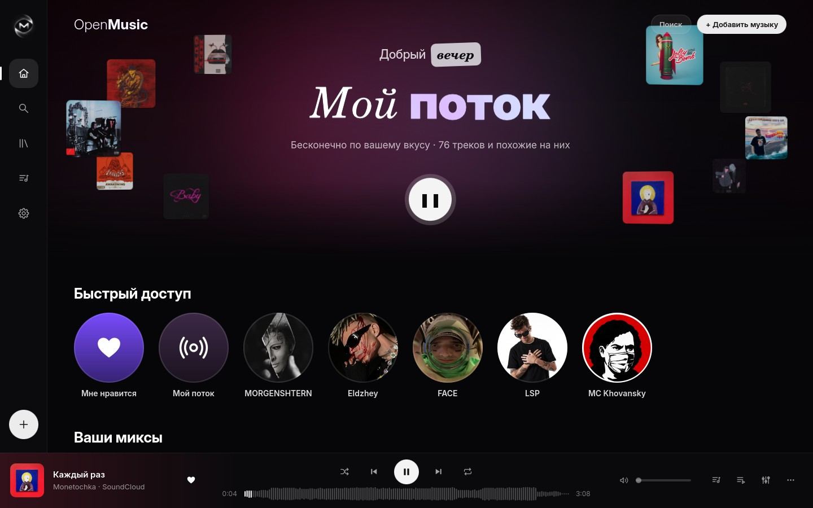
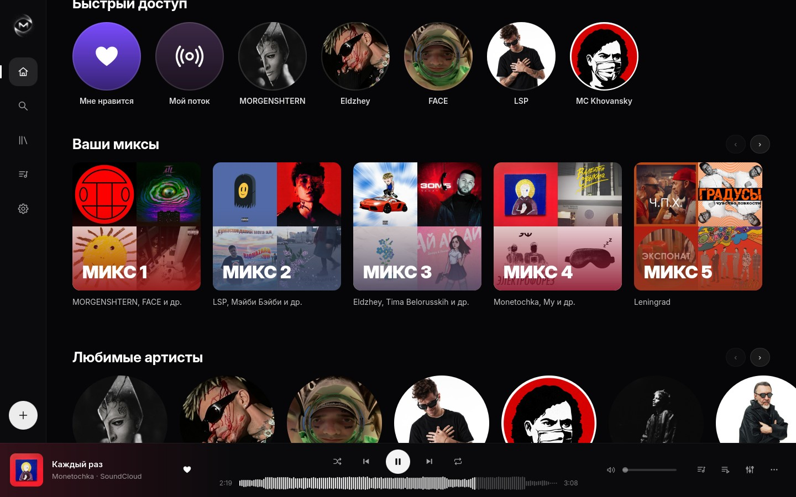
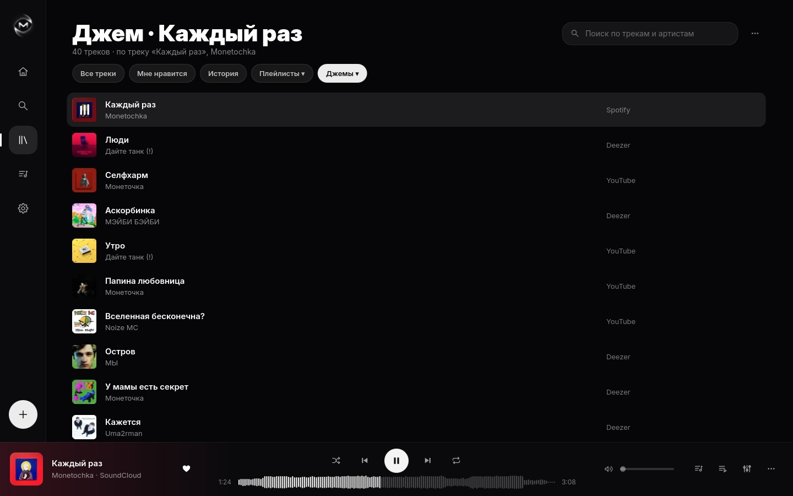
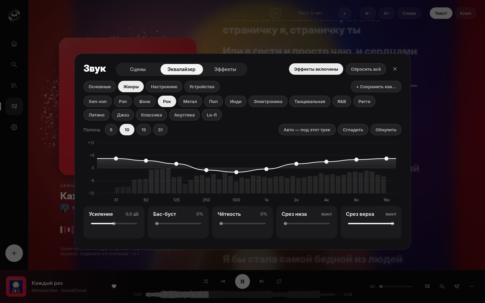
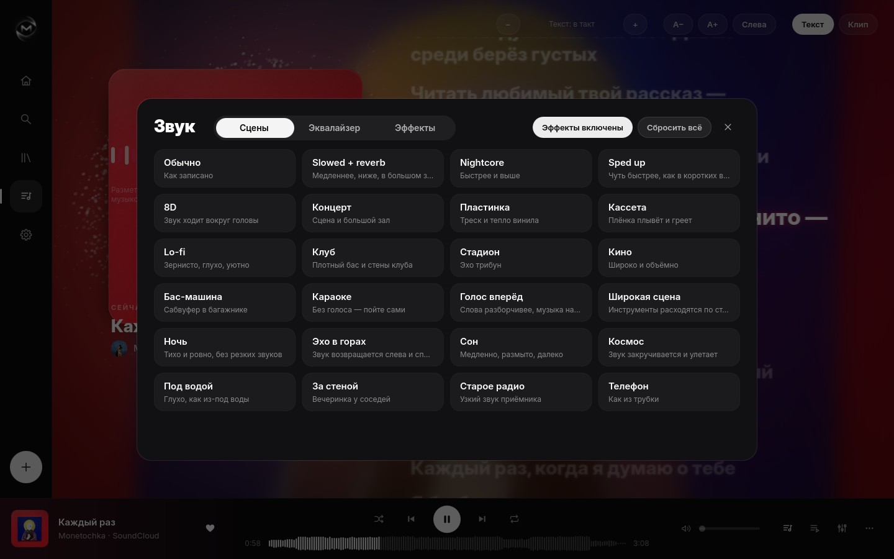
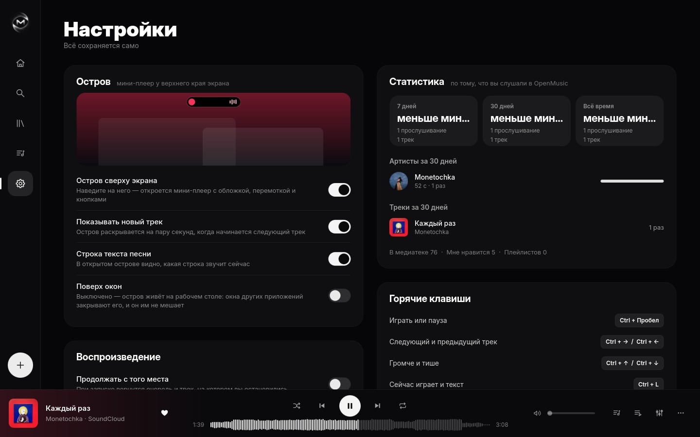
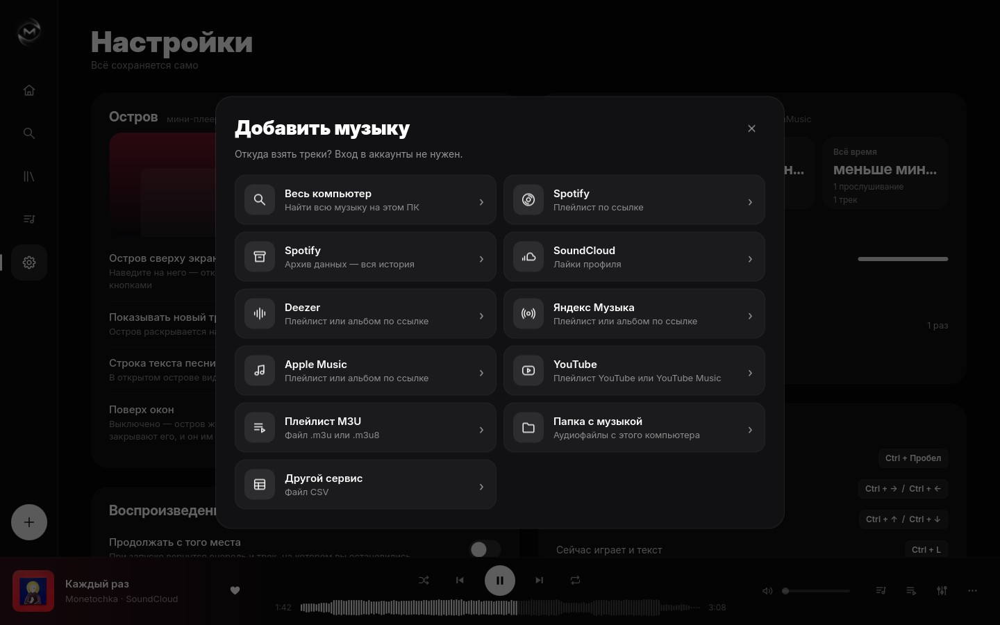

<div align="center">


# OpenMusic

**Вся твоя музыка в одном плеере для Linux и Windows**

Собирает вкус из Spotify, SoundCloud, Deezer, Яндекс Музыки, Apple Music и YouTube по обычной ссылке, сам находит звук, текст и обложки — без аккаунтов, ключей и подписок.


<br>



</div>

<br>

## ✨ Что умеет

<table>
<tr>
<td width="50%" valign="top">

### 🌊 Мой поток и миксы

Бесконечная музыка по твоему вкусу: треть — твои треки, остальное — похожие на них. Чем чаще что-то пропускаешь, тем реже оно попадается.

Миксы собираются сами: артисты медиатеки делятся на «круги» тех, кто звучит рядом, и каждый круг становится миксом из своих треков и новых.

</td>
<td width="50%"></td>
</tr>
<tr>
<td width="50%"></td>
<td width="50%" valign="top">

### 🎛 Джем

Правая кнопка по любому треку → **«Начать джем»**. Трек играет дальше, а к нему за несколько секунд собирается плейлист из 40 похожих. Когда он кончается, плеер сам находит ещё.

Похожее ищется сразу в трёх местах — Deezer, YouTube и SoundCloud. Ремиксы и slowed-версии отбрасываются, один артист не занимает весь список.

</td>
</tr>
<tr>
<td width="50%" valign="top">

### 🎤 Текст в такт

Строка, которая звучит сейчас, плавно выходит вперёд; щелчок по строке перематывает к ней. Есть режим **«Клип»** с огромными словами, как в лирик-видео.

Фон — живое поле в цветах обложки, полоски двигаются от настоящей громкости трека.

</td>
<td width="50%"></td>
</tr>
<tr>
<td width="50%"></td>
<td width="50%" valign="top">

### 🎚 Свой звук

Эквалайзер на **5, 10, 15 или 31 полосу**: кривую можно нарисовать мышью, выбрать из 38 пресетов или нажать **«Авто»** — подстроится под играющий трек.

Срезы низа и верха, бас-буст, ширина стерео, компрессор, ровная громкость.

</td>
</tr>
<tr>
<td width="50%" valign="top">

### 🪩 Сцены и эффекты

**24 сцены одним щелчком:** Slowed + reverb, Nightcore, 8D, Концерт, Кассета, Lo-fi, Под водой, Старое радио…

Или собери своё: семь помещений от студии до пещеры, эхо, хорус, фленджер, винил, «убрать голос» для караоке, скорость.

</td>
<td width="50%"></td>
</tr>
<tr>
<td width="50%"></td>
<td width="50%" valign="top">

### 🧑‍🎤 Страница артиста

Фото, популярные треки, релизы с их треками и похожие исполнители. Открывается щелчком по имени артиста где угодно.

</td>
</tr>
<tr>
<td width="50%" valign="top">

### 🏝 Остров, трей и медиаклавиши

Маленький остров у верхнего края экрана: показывает обложку и ритм, под курсором раскрывается в мини-плеер. Живёт на рабочем столе и не перекрывает окна других программ.

Работают медиаклавиши, виджет плеера KDE, экран блокировки и KDE Connect.

</td>
<td width="50%"></td>
</tr>
</table>

**И ещё:** поиск по SoundCloud · «Мне нравится», плейлисты и история · очередь, перемешивание, повтор · таймер сна · форма звука вместо полосы прокрутки · продолжение с того места, где остановился · статистика прослушиваний.

<br>

## 📥 Откуда берётся музыка

<table>
<tr>
<td width="50%" valign="top">

Нажми **«+»** и вставь ссылку — вход в аккаунт нигде не нужен.

- **Spotify** — открытый плейлист по ссылке или архив своих данных
- **SoundCloud** — профиль: загрузятся его лайки
- **Deezer** — плейлист или альбом
- **Яндекс Музыка** — плейлист или альбом
- **Apple Music** — плейлист или альбом
- **YouTube и YouTube Music** — плейлист
- **Весь компьютер** — музыка на дисках найдётся сама
- **Папка, M3U, CSV** — файлы с этого компьютера

Подробности про каждый источник и его ограничения — в [docs/DEVELOPMENT.md](docs/DEVELOPMENT.md#источники).

</td>
<td width="50%"></td>
</tr>
</table>

<br>

## 🚀 Установка и запуск

**Готовые сборки** лежат в [релизах](https://github.com/ParanoaiDev/OpenMusic/releases/latest):

| Система | Файл |
|---|---|
| **Windows 10/11** | `OpenMusic-…-windows-setup.exe` — установщик, или `…-windows-x64.zip` без установки |
| **Linux** | `OpenMusic-…-x86_64.AppImage` — сделать исполняемым и запустить, или `…-linux-x86_64.tar.gz` |

Python и Qt в сборках свои, ставить ничего не нужно. В Linux для формы звука и импорта папок пригодится `ffmpeg` из репозитория; в Windows он идёт вместе с приложением. Остров в сборке для Linux работает под X11, а под Wayland — только при запуске из исходников.

### Из исходников


Проверено на CachyOS (Arch) с KDE Plasma, Python 3.14 и PySide6 6.12.

```bash
# Arch, CachyOS, Manjaro
sudo pacman -S --needed pyside6 python-numpy yt-dlp ffmpeg layer-shell-qt

git clone https://github.com/ParanoaiDev/OpenMusic.git
cd OpenMusic
python3 app.py
```

На другом дистрибутиве поставь `ffmpeg` из его репозитория, а остальное — в виртуальное окружение:

```bash
python3 -m venv .venv && source .venv/bin/activate
pip install -r requirements.txt
python3 app.py
```

| Что | Зачем | Без него |
|---|---|---|
| **PySide6** | весь интерфейс | не запустится |
| **yt-dlp** | звук треков, лайки SoundCloud, плейлисты YouTube | треки не играют |
| **numpy** | эквалайзер и эффекты | звук идёт без обработки |
| **ffmpeg** | форма звука, теги файлов | нет волны в плеере и импорта папок |
| **layer-shell-qt** | остров на Wayland | остров выключен |

Медиатека, лайки, кэш звука и обложек лежат в `~/.local/share/OpenMusic` и никуда не отправляются.

<br>

## ⌨️ Горячие клавиши

| Клавиши | Действие |
|---|---|
| <kbd>Ctrl</kbd> + <kbd>Пробел</kbd> | играть или пауза |
| <kbd>Ctrl</kbd> + <kbd>→</kbd> / <kbd>←</kbd> | следующий и предыдущий трек |
| <kbd>Ctrl</kbd> + <kbd>↑</kbd> / <kbd>↓</kbd> | громче и тише |
| <kbd>Ctrl</kbd> + <kbd>K</kbd> | поиск |
| <kbd>Ctrl</kbd> + <kbd>L</kbd> | «Сейчас играет» и текст |
| <kbd>Ctrl</kbd> + <kbd>I</kbd> | добавить музыку |
| <kbd>Ctrl</kbd> + <kbd>O</kbd> | открыть аудиофайл |
| <kbd>Ctrl</kbd> + <kbd>,</kbd> | настройки |
| <kbd>Alt</kbd> + <kbd>←</kbd> | назад со страницы артиста |

<br>

## 🔍 Как это работает

OpenMusic не хранит и не раздаёт музыку. Медиатека — это список «артист — название», который он читает с открытых страниц сервисов. Всё остальное находится по этому списку:

- **Звук** ищется на SoundCloud через [yt-dlp](https://github.com/yt-dlp/yt-dlp). Из подходящих загрузок выбирается страница самого артиста или самая слушаемая, каверы и ускоренные версии проигрывают.
- **Текст** с разметкой по времени берётся из [LRCLIB](https://lrclib.net).
- **Обложки** — из Spotify, iTunes и Deezer, фото и релизы артистов — из Deezer.
- **Похожие треки** — радио артиста в Deezer, микс YouTube и станция SoundCloud, смешанные в один список.

Честно об ограничениях:

- без входа Spotify отдаёт только первые 100 треков плейлиста, а «Любимые треки» закрыты совсем;
- трека может не оказаться на SoundCloud — тогда он пропускается с сообщением;
- всё держится на открытых страницах и API без ключей, поэтому что-то может сломаться, когда сервис меняет сайт. Для SoundCloud и YouTube первым делом обнови yt-dlp.

<br>

## 🧩 Разработчикам

Интерфейс целиком на Qt Quick (`ui/qml`), логика — на Python без Qt в корне проекта, звук обрабатывается своим движком на numpy.

```bash
python3 -m unittest discover tests     # 173 теста, сеть не нужна
OPENMUSIC_INTRO=0 python3 app.py       # запуск без заставки
```

Что в каком модуле и как устроены импорт, подбор, текст и звук — в [docs/DEVELOPMENT.md](docs/DEVELOPMENT.md).

<br>

---

<div align="center">

OpenMusic — неофициальный проект и не связан со Spotify, SoundCloud, Deezer, Яндексом, Apple и YouTube.<br>
Музыка, тексты и обложки принадлежат их правообладателям.

</div>
